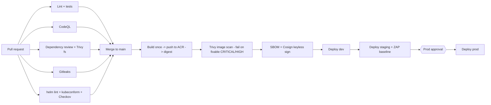

# Deployment guide

Secure, multi-environment CI/CD for `multi-env-api` on Azure Kubernetes Service (AKS) using
GitHub Actions, Helm, Azure Container Registry (ACR), GitHub OIDC (no stored cloud credentials),
Key Vault via the Secrets Store CSI driver, Azure SQL, and Application Gateway for Containers (AGC).

> Everything under **One-time setup** is run **by you**. The repository tooling never creates cloud resources.

## 1. Pipeline



The **same image digest** is promoted through every environment; nothing is rebuilt.

| Stage | Workflow | What it does |
|---|---|---|
| PR checks | `pr.yml` | ruff + pytest; CodeQL (SAST); dependency-review + Trivy fs (SCA); Gitleaks; `helm lint`, `kubeconform`, Checkov on rendered chart + Dockerfile. SARIF goes to code scanning. |
| Build | `cicd.yml` / `build` | One build, push `ACR/multi-env-api:<sha>`, capture digest. Trivy image gate, SPDX SBOM, Cosign keyless signature + SBOM attestation. Uses its own `build` environment/identity (AcrPush only). |
| Deploy | `deploy.yml` (reusable) | Verifies the Cosign signature (must come from `cicd.yml` on `main`), OIDC login, `helm upgrade --install --atomic --wait --timeout 10m`, smoke test on `/readyz`, optional ZAP baseline (staging) failing on high-risk alerts. |
| Promotion | `cicd.yml` | dev -> staging -> prod, each gated on the previous one. Prod waits for GitHub Environment reviewers. |

Concurrency: `deploy-<env>` groups mean two deploys to the same environment never overlap
(`cancel-in-progress: false`); a newer queued run replaces an older *pending* one.

## 2. One-time setup checklist

- [ ] 2.1 Variables
- [ ] 2.2 AKS prerequisites
- [ ] 2.3 Namespaces
- [ ] 2.4 GitHub deploy identities (OIDC) + RBAC
- [ ] 2.5 App (workload) identities, Key Vault, Azure SQL
- [ ] 2.6 Application Gateway for Containers
- [ ] 2.7 GitHub repository + Environments + variables
- [ ] 2.8 First run and branch protection

### 2.1 Variables (adjust and export in your shell)

```bash
export SUB=<subscription-id>            TENANT=<tenant-id>         LOC=<region>
export RG=<resource-group>              AKS=<aks-cluster>          ACR=<acr-name>
export KV=<key-vault-name>              SQL_SERVER=<sqlserver-name> SQL_DB=<database>
export GH_REPO=<org-or-user>/multi-env-api
export APP=multi-env-api
az account set --subscription "$SUB"
export AKS_ID=$(az aks show -g $RG -n $AKS --query id -o tsv)
export ACR_ID=$(az acr show -n $ACR --query id -o tsv)
export KV_ID=$(az keyvault show -n $KV --query id -o tsv)
```

### 2.2 AKS prerequisites (Kubernetes >= 1.30 for the native `preStop` sleep)

```bash
# Entra ID + Azure RBAC for Kubernetes authorization, OIDC issuer, Workload Identity, Key Vault CSI
az aks update -g $RG -n $AKS --enable-aad --enable-azure-rbac
az aks update -g $RG -n $AKS --enable-oidc-issuer --enable-workload-identity
az aks enable-addons -g $RG -n $AKS --addons azure-keyvault-secrets-provider
# Let nodes pull from ACR
az aks update -g $RG -n $AKS --attach-acr $ACR
export OIDC_ISSUER=$(az aks show -g $RG -n $AKS --query oidcIssuerProfile.issuerUrl -o tsv)
```

The cluster also needs a NetworkPolicy engine (Azure NPM or Cilium) and the AGC ALB controller (2.6).

### 2.3 Namespaces (one per environment)

Pods in this chart satisfy the `restricted` Pod Security Standard, so enforce it:

```bash
az aks get-credentials -g $RG -n $AKS    # as a cluster admin
for e in dev staging prod; do
  kubectl create namespace $APP-$e
  kubectl label namespace $APP-$e pod-security.kubernetes.io/enforce=restricted
done
```

### 2.4 GitHub deploy identities (OIDC federation) and RBAC

One user-assigned managed identity per environment, plus one for the build. Each has a
federated credential bound to its **GitHub Environment**, so only jobs running in that
environment can obtain its token.

```bash
for e in build dev staging prod; do
  az identity create -g $RG -n id-$APP-gh-$e -l $LOC
  az identity federated-credential create -g $RG --identity-name id-$APP-gh-$e \
    --name github-$e \
    --issuer https://token.actions.githubusercontent.com \
    --subject "repo:$GH_REPO:environment:$e" \
    --audiences api://AzureADTokenExchange
done

# Role assignments (principal ids)
pid() { az identity show -g $RG -n id-$APP-gh-$1 --query principalId -o tsv; }

# Build: push images only
az role assignment create --assignee-object-id $(pid build) --assignee-principal-type ServicePrincipal \
  --role AcrPush --scope $ACR_ID

for e in dev staging prod; do
  # Read the signed image (cosign verify)
  az role assignment create --assignee-object-id $(pid $e) --assignee-principal-type ServicePrincipal \
    --role AcrPull --scope $ACR_ID
  # Fetch kubeconfig for the cluster
  az role assignment create --assignee-object-id $(pid $e) --assignee-principal-type ServicePrincipal \
    --role "Azure Kubernetes Service Cluster User Role" --scope $AKS_ID
  # Deploy rights ONLY inside this environment's namespace
  az role assignment create --assignee-object-id $(pid $e) --assignee-principal-type ServicePrincipal \
    --role "Azure Kubernetes Service RBAC Admin" --scope "$AKS_ID/namespaces/$APP-$e"
done
```

Record the client ids (used in 2.7): `az identity show -g $RG -n id-$APP-gh-<env> --query clientId -o tsv`.

### 2.5 Workload (pod) identities, Key Vault and Azure SQL

One identity per environment used **by the running pods** (and the migration Job). The federated
subject is the chart's ServiceAccount: `system:serviceaccount:<namespace>:multi-env-api`.

```bash
for e in dev staging prod; do
  az identity create -g $RG -n id-$APP-app-$e -l $LOC
  az identity federated-credential create -g $RG --identity-name id-$APP-app-$e \
    --name aks-$e --issuer "$OIDC_ISSUER" \
    --subject "system:serviceaccount:$APP-$e:$APP" \
    --audiences api://AzureADTokenExchange
  # Key Vault: read secrets (Key Vault must use the Azure RBAC permission model)
  az role assignment create --assignee-object-id $(az identity show -g $RG -n id-$APP-app-$e --query principalId -o tsv) \
    --assignee-principal-type ServicePrincipal --role "Key Vault Secrets User" --scope $KV_ID
done
```

**Azure SQL** (default `DB_AUTH=entra`: no password exists). The SQL server needs an Entra admin; connect
as that admin and run, per environment database (replace the identity name):

```bash
sqlcmd -S $SQL_SERVER.database.windows.net -d $SQL_DB -G -Q "
CREATE USER [id-$APP-app-dev] FROM EXTERNAL PROVIDER;
ALTER ROLE db_datareader ADD MEMBER [id-$APP-app-dev];
ALTER ROLE db_datawriter ADD MEMBER [id-$APP-app-dev];
ALTER ROLE db_ddladmin  ADD MEMBER [id-$APP-app-dev];  -- needed by the Alembic migration Job"
```

`db_ddladmin` is granted because the migration Job runs under the same identity as the app. To tighten
this later, give migrations their own identity/ServiceAccount.

Only if you use `DB_AUTH=sql`: store `db-user` / `db-password` in Key Vault and list them in
`keyVault.objects` of the environment's values file (never put values in the repo).

### 2.6 Application Gateway for Containers (AGC)

Install the ALB controller per the Azure docs ("Quickstart: Deploy Application Gateway for Containers ALB Controller"),
then create the resources the chart references:

```bash
az network alb create -g $RG -n alb-$APP
az network alb frontend create -g $RG --alb-name alb-$APP -n fe-$APP
# Dedicated, delegated subnet for the association
az network vnet subnet update -g $RG --vnet-name <vnet> -n <agc-subnet> \
  --delegations 'Microsoft.ServiceNetworking/trafficControllers'
az network alb association create -g $RG --alb-name alb-$APP -n assoc-$APP \
  --subnet $(az network vnet subnet show -g $RG --vnet-name <vnet> -n <agc-subnet> --query id -o tsv)
export ALB_ID=$(az network alb show -g $RG -n alb-$APP --query id -o tsv)
```

`ALB_ID`, the frontend name (`fe-$APP`), and the AGC subnet CIDR become environment variables (2.7).
Point each hostname's DNS (CNAME) at the frontend FQDN
(`az network alb frontend show -g $RG --alb-name alb-$APP -n fe-$APP --query fqdn -o tsv`). For HTTPS, put a
certificate in a TLS Secret in the namespace and set `TLS_SECRET_NAME`.

### 2.7 GitHub: repository, Environments and variables

Requires the GitHub CLI authenticated with admin rights on the repository.

```bash
# Repository-level variables
gh variable set ACR_LOGIN_SERVER --repo $GH_REPO --body "$ACR.azurecr.io"
gh variable set ACR_NAME         --repo $GH_REPO --body "$ACR"

# Environments, restricted to deployments from main
for e in build dev staging prod; do
  gh api -X PUT repos/$GH_REPO/environments/$e \
    -F 'deployment_branch_policy[protected_branches]=false' \
    -F 'deployment_branch_policy[custom_branch_policies]=true'
  gh api -X POST repos/$GH_REPO/environments/$e/deployment-branch-policies -f name=main
done

# Required reviewers on prod (use real user or team ids)
REVIEWER_ID=$(gh api users/<github-username> --jq .id)
gh api -X PUT repos/$GH_REPO/environments/prod --input - <<JSON
{"reviewers":[{"type":"User","id":$REVIEWER_ID}],
 "deployment_branch_policy":{"protected_branches":false,"custom_branch_policies":true}}
JSON
```

Environment variables (set for each of `build`, `dev`, `staging`, `prod` as applicable):

```bash
setv() { gh variable set "$2" --env "$1" --repo $GH_REPO --body "$3"; }
cid() { az identity show -g $RG -n "$1" --query clientId -o tsv; }

for e in build dev staging prod; do
  setv $e AZURE_TENANT_ID $TENANT
  setv $e AZURE_SUBSCRIPTION_ID $SUB
  setv $e AZURE_CLIENT_ID $(cid id-$APP-gh-$e)
done

setv build ACR_NAME $ACR   # (also set at repo level above)

for e in dev staging prod; do
  setv $e AKS_CLUSTER $AKS
  setv $e AKS_RESOURCE_GROUP $RG
  setv $e WORKLOAD_IDENTITY_CLIENT_ID $(cid id-$APP-app-$e)
  setv $e DB_SERVER $SQL_SERVER.database.windows.net
  setv $e DB_NAME <database-for-$e>
  setv $e ALB_ID "$ALB_ID"
  setv $e AGC_FRONTEND fe-$APP
  setv $e AGC_SUBNET_CIDR <agc-subnet-cidr>
  setv $e APP_HOSTNAME <api-$e.example.com>
  setv $e APP_URL https://<api-$e.example.com>
  # optional: TLS_SECRET_NAME, KEYVAULT_NAME, K8S_NAMESPACE (default multi-env-api-<env>)
done
```

Also enable: **Settings -> Code security** (dependency graph, code scanning, secret scanning). If the repo
belongs to an organisation, add a `GITLEAKS_LICENSE` repository secret.

### 2.8 First run and branch protection

`main` triggers the full pipeline, so finish 2.1-2.7 **before** `main` first receives the code
(or the first run fails at Azure login). Then publish `main` from the reviewed branch:

```bash
git push origin feat/aks-cicd-pipeline:main
```

Afterwards protect `main` (names are the job names in `pr.yml`; a check must have run once to be selectable):

```bash
gh api -X PUT repos/$GH_REPO/branches/main/protection --input - <<'JSON'
{
  "required_status_checks": {"strict": true, "contexts": [
    "Lint and unit tests", "CodeQL (Python)", "SCA - dependency review",
    "SCA - Trivy filesystem scan", "Secret scan - Gitleaks",
    "IaC - helm lint, kubeconform, Checkov"]},
  "enforce_admins": true,
  "required_pull_request_reviews": {"required_approving_review_count": 1, "dismiss_stale_reviews": true},
  "restrictions": null,
  "required_linear_history": true,
  "allow_force_pushes": false,
  "allow_deletions": false
}
JSON
```

## 3. Operating notes

- **Migrations** run as a Helm pre-install/pre-upgrade hook Job and **must be backward compatible**
  (expand/contract); see `charts/multi-env-api/README.md`. The previous app version runs against the new schema
  during rollout and after any rollback.
- **Secrets** never appear in values files or workflows. Identifiers (client/tenant ids) are non-secret variables.
- **Dependabot** updates pip, the Docker base image digest, and pinned Actions SHAs weekly.
- **DAST** runs only for staging (`run_dast: true`) against that environment's `APP_URL`.

## 4. Rollback

`--atomic` already rolls back automatically if an upgrade fails. For a bad release that deployed successfully:

### 4.1 `helm rollback` (fastest; needs namespace access)

```bash
az aks get-credentials -g $RG -n $AKS
helm history $APP -n $APP-prod
helm rollback $APP <REVISION> -n $APP-prod --wait --timeout 10m
```

Helm does not revert the database. This is safe only because migrations are expand/contract.

### 4.2 Redeploy a previous digest (audited, goes through the pipeline)

1. Find the digest of the last good release:
   ```bash
   az acr manifest list-metadata -r $ACR -n multi-env-api \
     --query "[].{digest:digest,tags:tags,pushed:lastUpdateTime}" -o table
   ```
   or read it from the earlier `CI/CD` run's `build` job summary.
2. In GitHub **Actions**, open that earlier successful `CI/CD` run and **Re-run** the `Deploy prod` job.
   It redeploys that run's digest with that run's chart, still passing the signature check and prod approval.
3. Alternative: revert the commit on `main`; the pipeline builds, signs and promotes a new digest.

Never deploy by tag: the chart only accepts `image.digest`, and `deploy.yml` rejects anything that is not
`sha256:<64 hex>` or not signed by `cicd.yml` on `main`.

## 5. Troubleshooting

| Symptom | Likely cause |
|---|---|
| `azure/login` fails `AADSTS70021` | Federated credential subject does not match `repo:<org>/<repo>:environment:<env>` |
| `helm` forbidden | Deploy identity lacks `RBAC Admin` on `.../namespaces/<ns>` |
| `cosign verify` no signatures | Image not built by `cicd.yml` on `main`, or identity lacks `AcrPull` |
| Pods `CreateContainerConfigError` on secrets mount | Missing `Key Vault Secrets User` or wrong federated subject for the app identity |
| `/readyz` 503 | Pod identity not created as SQL user, or NetworkPolicy/AGC subnet CIDR wrong |
